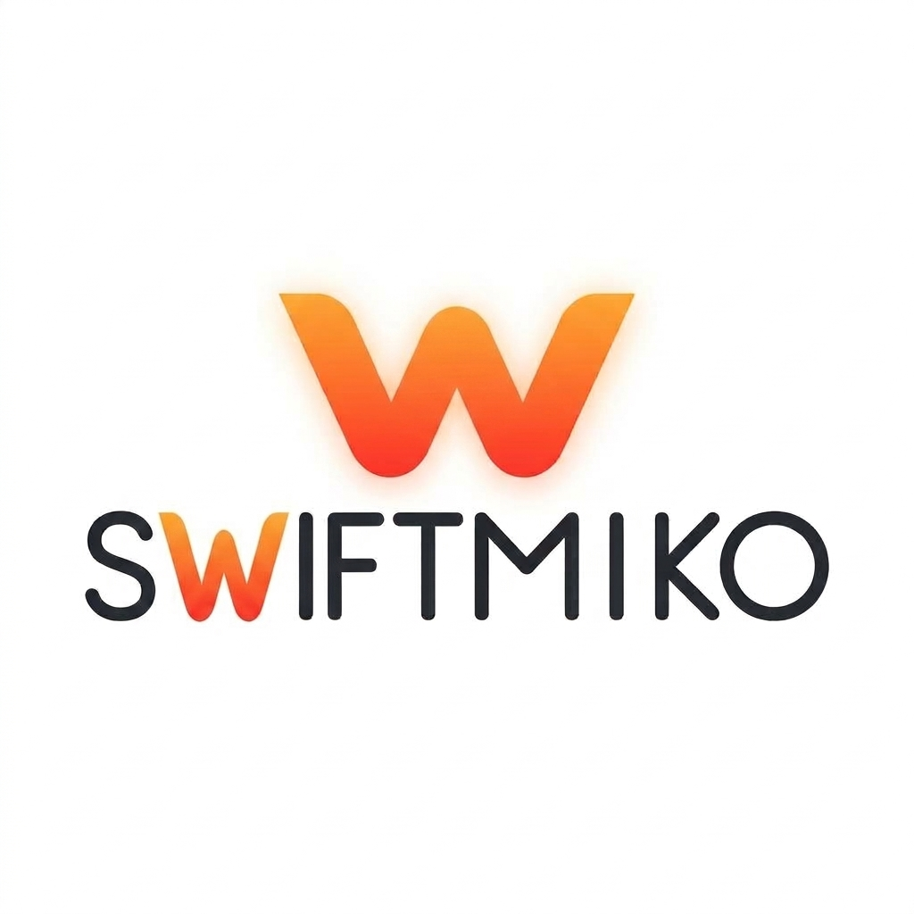

# README.md

<p align="center">
  
</p>

<h1 align="center">Swiftmiko</h1>

<p align="center">
  <a href="https://github.com/stelicho/Swiftmiko/actions/workflows/ci.yml">
    
  </a>
  <a href="#requirements">
    
  </a>
  <a href="https://github.com/stelicho/Swiftmiko/actions/workflows/ci.yml">
    
  </a>
  <a href="https://github.com/stelicho/Swiftmiko/graphs/contributors">
    
  </a>
</p>

<p align="center">
  A native Swift port of <a href="https://github.com/ktbyers/netmiko">Netmiko</a> —
  multi-vendor network device SSH/Telnet automation, built for Swift.
  Cross-platform: macOS, iOS, iPadOS, Linux, and Windows.
</p>

---

## What Is This?

Swiftmiko brings Netmiko's device-abstraction model to Swift:
one consistent API — `connect()`, `sendCommand(_:)`, `sendConfigSet(_:)`,
`enterEnableMode(secret:)` — across 150+ network vendor CLIs, from
Cisco IOS to Juniper JunOS to MikroTik RouterOS to Nokia SR OS and
far beyond. If you already know Netmiko, Swiftmiko should feel
immediately familiar; if you're coming from Swift, it should feel
like a normal, modern async Swift library.

```swift
import Swiftmiko

let profile = ConnectionProfile(
    host: "192.168.1.1",
    deviceType: "cisco_ios",
    username: "admin",
    auth: .password("changeme")
)

let connection = try await SSHDispatcher.connectHandler(profile: profile)
try await connection.enterEnableMode(secret: "enablepass")
let output = try await connection.sendCommand("show version")
print(output)
await connection.disconnect()
```

## Status

**This project is under active development and has not yet been
verified against all listed real or emulated hardware.** Every driver listed in
[`PLATFORMS.md`](./PLATFORMS.md) has been translated from Netmiko's
Python source and compiles against Swiftmiko's core API, but none has
been confirmed working end-to-end yet. Testing against GNS3 and real
devices is actively in progress — see `PLATFORMS.md` for the current
per-platform status and how to help verify one.

Treat this as **pre-alpha**. APIs may change without notice until the
first tagged release.

## Getting Started

### Requirements

- Swift 6.1+ (the package resolves swift-nio / swift-crypto manifests
  that require it — `swift --version` to check)
- The core `Swiftmiko` library and CLI tools build on macOS 14+, iOS 16+,
  iPadOS 16+, Linux, and Windows
- Xcode 16+ if you're on an Apple platform, or if you want to run the
  `Examples/` apps — those are SwiftUI and remain Apple-only even
  though the library itself isn't

### Installing

Swiftmiko is a Swift Package. Add it to your `Package.swift`:

```swift
dependencies: [
    .package(url: "https://github.com/stelicho/Swiftmiko.git", branch: "main")
]
```

Or in Xcode: **File → Add Package Dependencies...** and paste the
repository URL.

### Examples

The `Examples/` directory contains several small SwiftUI apps
demonstrating real usage against real devices — a VLAN viewer, an
enable-mode demo, a running-config fetcher, a multi-vendor command
runner, a generic Linux SSH demo, a Ubiquiti command runner (UniFi
Switch, EdgeSwitch, EdgeRouter), an Open vSwitch topology browser, and
[`NokiaSrlDemo`](./Examples/NokiaSrlDemo), a command runner for Nokia
SR Linux (`nokia_srl`) — handy for testing against a containerlab/SR
Linux Docker image. Note this targets a different platform than
`NokiaDemo` below, which is SR OS, not SR Linux — the two Nokia
drivers don't share a CLI or a config model.
[`MultiVendorDemoPad`](./Examples/MultiVendorDemoPad) is the iPhone/
iPad sibling of the multi-vendor command runner — same platform
picker and command set, but with the connection form and platform
choice behind a toolbar-triggered sheet (`ConnectSheet.swift`) instead
of always-visible fields, since the macOS layout doesn't fit a phone
screen.
Each is its own Xcode target; open `Swiftmiko.xcworkspace` (or the
project directly) and switch schemes to try one.

Four more focus on a single driver's own idiosyncrasies rather than
generic command-running:
[`JuniperDemo`](./Examples/JuniperDemo) drives JunOS's candidate-config
commit workflow (plain/confirmed/check-only/commented commits, discard
on exit);
[`NokiaDemo`](./Examples/NokiaDemo) detects and surfaces SR OS's two
CLI dialects (classical vs. model-driven) and their different
config/commit behavior;
[`MikrotikDemo`](./Examples/MikrotikDemo) connects to RouterOS, whose
driver smuggles terminal settings into the SSH username itself and
absorbs several possible post-login prompts before `connect()` returns;
[`PaloAltoDemo`](./Examples/PaloAltoDemo) drives PAN-OS's partial-commit
scoping (device-and-network / policy-and-objects / vsys / no-vsys).
PAN-OS's usual SSH auth method — keyboard-interactive (RFC 4256),
where the server drives a sequence of named prompts, sometimes a EULA
banner and a password prompt in two separate rounds — is implemented
down at the transport layer (`Sources/NIOSSHChannel.swift` and the
vendored `swift-nio-ssh` fork), not just this demo, so it applies to
any `paloalto_panos` connection using password auth.

Three more each focus on a single transport or feature rather than a
vendor's CLI quirks:
[`TelnetDemo`](./Examples/TelnetDemo) connects over plaintext Telnet
(`cisco_ios_telnet`, port 23) instead of SSH;
[`SCPDemo`](./Examples/SCPDemo) puts and gets files against a Cisco IOS
device via the `fileTransfer()` helper, showing the
exists/transferred/verified result of each attempt;
[`SNMPDemo`](./Examples/SNMPDemo) pairs `SNMPDetect.autodetect()` with a
minimal real SNMP v1/v2c GET transport written for the demo (the
library itself only ships the autodetection logic, not a wire client —
see `SNMPTransport` in `Sources/SNMPAutodetect.swift`) to identify a
device from its `sysDescr`.

[`CommandRunnerWebDemo`](./Examples/CommandRunnerWebDemo) is the odd
one out — a browser-based sibling of `CommandRunnerDemo` built with
[Vapor](https://vapor.codes) instead of SwiftUI. It's a standalone
Swift package, not an Xcode project: `cd` into it and `swift run`,
then open `http://localhost:8080`. See its own README for details.

[`CommandRunnerTerminalDemo`](./Examples/CommandRunnerTerminalDemo) is
another standalone package, not an Xcode project — a plain terminal
version of the same idea with no SwiftUI and no web framework, just
`Foundation` and `Swiftmiko`. It builds and runs on Linux and Windows
too, not just macOS — CI builds it on all three.

[`ScriptDemo`](./Examples/ScriptDemo) is the non-interactive
counterpart: a flag-driven script (`--host`/`--username`/`--command`/
`--allow-legacy-ciphers`, no YAML inventory file, no REPL) targeting
Cisco IOS, proof that Swiftmiko scripts the way Netmiko does — closer
to something you'd drop into a cron job or CI pipeline than a prompt
you sit and type into. Also a standalone package, also cross-platform.

[`CLIToolsDemo`](./Examples/CLIToolsDemo) isn't an app at all — it's a
walkthrough and sample inventory file for the command-line tools
already built into the main package (`swiftmiko-show`, `swiftmiko-cfg`,
`swiftmiko-grep`, `swiftmiko-encrypt`, `swiftmiko-bulk-encrypt`).

## Documentation

- [`PLATFORMS.md`](./PLATFORMS.md) — full list of supported device
  types and their current testing status
- [`EXAMPLES.md`](./EXAMPLES.md) — common connection patterns: enable
  mode, config changes, session logging, SCP, SSH/SNMP autodetection,
  terminal servers
- [`VENDOR.md`](./VENDOR.md) — how to add a new vendor driver
- [`TESTING.md`](./TESTING.md) — the test suite, and how to verify a
  platform against real/emulated hardware
- [`ENCRYPTION_HANDLING.md`](./ENCRYPTION_HANDLING.md) — encrypting
  credentials in `.swiftmiko.yml` for the CLI tools
- [`COMMON_ISSUES.md`](./COMMON_ISSUES.md) — FAQ and known gaps
- [`CONTRIBUTING.md`](./CONTRIBUTING.md) — how to build, test, and
  submit a change
- Inline documentation comments throughout the source explain how
  each driver maps back to its corresponding file in Netmiko's own
  codebase, including notes on any behavioral differences

## Relationship to Netmiko

Swiftmiko is a from-scratch reimplementation, not a wrapper or
bridge — there is no Python runtime involved anywhere. Every driver
was translated by hand from Netmiko's actual source, preserving
vendor-specific quirks, workarounds, and (where found) even genuine
upstream bugs, each called out explicitly in code comments rather
than silently "fixed," since a silent fix risks changing behavior
that hasn't been validated against real hardware. Full credit to
[Kirk Byers](https://github.com/ktbyers) and the Netmiko community —
this project exists because that one does.

## Contributing

See [`CONTRIBUTING.md`](./CONTRIBUTING.md). The single most valuable
thing right now is testing a platform against real or emulated
hardware and reporting back — especially anything still marked ⬜
Untested in [`PLATFORMS.md`](./PLATFORMS.md).

## License

MIT
